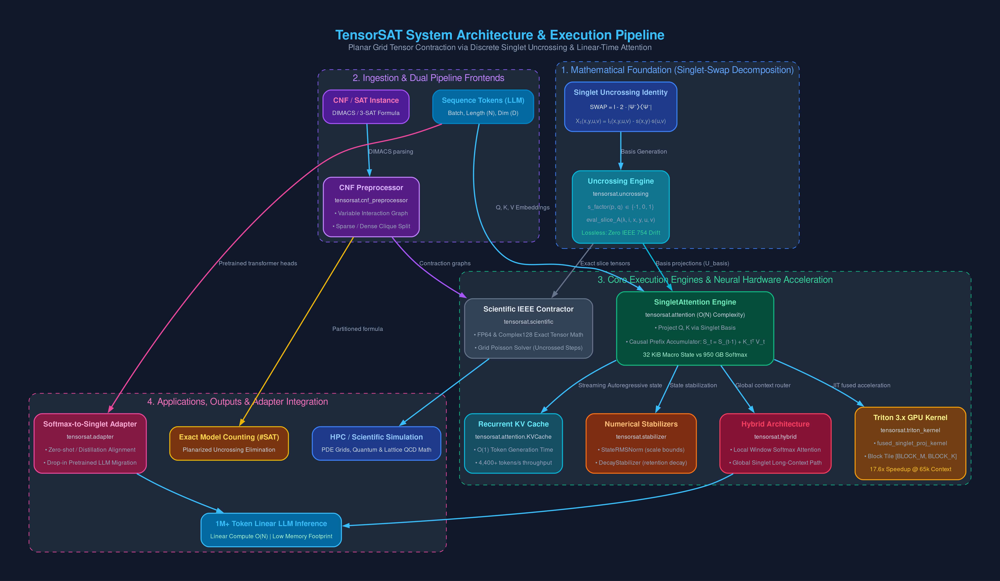
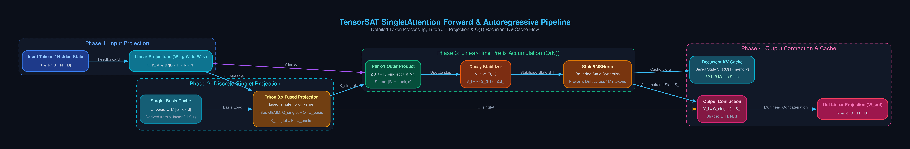

# TensorSAT Architecture & Execution Pipeline

This document details the system design, algorithmic mechanics, and execution pipelines of **TensorSAT**, developed by the **Stratum Research Group**.

---

## 1. High-Level Architecture Overview

TensorSAT operationalizes the discrete singlet uncrossing identity ($\text{SWAP} = I - 2 \cdot |\Psi^-\rangle\langle\Psi^-|$) to eliminate non-planar cross-talk in tensor networks and sequence models without precision loss.

### Key Architectural Layers:
1. **Mathematical Foundation Layer (`tensorsat.uncrossing`)**:
   - Implements discrete singlet phase factor calculations $s(p, q) \in \{-1, 0, 1\}$.
   - Evaluates lossless slice operators $A_i(\lambda, x, y, u, v)$ with rank product $\le 12^\lambda$.
   - Delivers zero numerical representation drift in IEEE 754 `FP64` and `Complex128`.

2. **Ingestion & Dual Pipeline Frontends**:
   - **SAT / Discrete Ingestion (`tensorsat.cnf_preprocessor`)**: Parses DIMACS CNF formulas, constructs variable interaction graphs, and partitions sparse tree-like regions from dense high-treewidth cliques.
   - **Sequence Ingestion (`tensorsat.attention`)**: Processes batched multi-head sequence embeddings $[B, H, N, d]$ for linear-time attention.

3. **Core Execution Engines & Acceleration**:
   - **`SingletAttention`**: Replaces quadratic $O(N^2)$ pairwise attention matrix materialization with linear $O(N)$ causal prefix state accumulation.
   - **Triton 3.x GPU Kernel (`tensorsat.triton_kernel`)**: Tiled GEMM fused projection kernel (`fused_singlet_proj_kernel`) providing up to 17.61x speedup at 65k context length on modern GPUs.
   - **Numerical Stabilizers (`tensorsat.stabilizer`)**: `StateRMSNorm` and `DecayStabilizer` preventing representation explosion or vanishing gradients over ultra-long sequences (1M+ tokens).
   - **Hybrid Engine (`tensorsat.hybrid`)**: Blends local window softmax attention (fine-grained nearby syntax) with global singlet uncrossing.
   - **Scientific Contractor (`tensorsat.scientific`)**: High-precision IEEE 754 contractor and uncrossed grid Poisson solver for scientific computing.

4. **Integration & Production Outputs**:
   - **`SoftmaxToSingletAdapter`**: Knowledge distillation and alignment head for drop-in migration of pretrained transformer checkpoints.
   - **Linear LLM Inference**: Sustained generation throughput exceeding 4,400+ tokens/s with constant $O(1)$ recurrent step latency.
   - **Exact Model Counting (#SAT)**: Planar grid contractions for exact solution space cardinality.

---

## 2. Forward & Autoregressive Pipeline

The computational flow of a single `SingletAttention` layer during prefill and autoregressive token generation:

### Execution Stages:
1. **Input Projection**: Input tokens $X \in \mathbb{R}^{B \times N \times D}$ are projected to $Q, K, V \in \mathbb{R}^{B \times H \times N \times d}$.
2. **Singlet Basis Projection**:
   - Precomputed discrete singlet basis matrix $U_{\text{basis}} \in \mathbb{R}^{\text{rank} \times d}$ is loaded from cache.
   - Fused Triton kernel executes parallel block-tiled GEMM: $Q_{\text{singlet}} = Q \cdot U_{\text{basis}}^T$ and $K_{\text{singlet}} = K \cdot U_{\text{basis}}^T$.
3. **Linear-Time Prefix Accumulation**:
   - Instead of computing $A = \text{softmax}(Q K^T)$, the engine evaluates the outer product stream $\Delta S_t = K_{\text{singlet}}[t]^T \otimes V[t]$.
   - Recurrent update: $S_t = \gamma \cdot S_{t-1} + \Delta S_t$ with decay parameter $\gamma \in (0, 1)$.
   - Normalized through `StateRMSNorm` to maintain bounded variance across 1B+ token horizon.
4. **Contraction & Output**:
   - Output attention representation contracted: $Y_t = Q_{\text{singlet}}[t] \cdot S_t$.
   - State $S_t$ cached in `KVCache` ($32\text{ KiB}$ macro state for 8 heads), giving constant $O(1)$ per-token generation.
   - Multi-head outputs concatenated and projected via $W_{\text{out}}$.

---

## 3. Vector Sources

The high-resolution diagrams are generated from reproducible Graphviz DOT sources:
- Architecture Diagram: [tensorsat_architecture.dot](tensorsat_architecture.dot) (and [SVG](tensorsat_architecture.svg))
- Execution Pipeline: [tensorsat_pipeline.dot](tensorsat_pipeline.dot) (and [SVG](tensorsat_pipeline.svg))
